

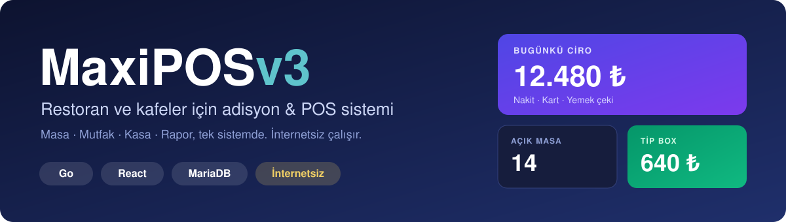

 

**Masa, mutfak, kasa ve raporlama tek sistemde. Dükkânınızdaki mini PC üzerinde, internet olmadan çalışır.**

[Özellikler](#-özellikler) · [Nasıl çalışır](#-nasıl-çalışır) · [Ekranlar](#-ekran-görüntüleri) · [Teknoloji](#-teknoloji) · [Kurulum](#-kurulum) · [İletişim](#-demo-ve-iletişim)

> **Not:** Bu depo **MaxiPOS** ürününün tanıtım sayfasıdır. Kaynak kodlar ticari ve güvenlik nedenleriyle kapalı tutulur. Demo, fiyat ve özel geliştirme için [iletişim](#-demo-ve-iletişim) bölümüne bakın.

---

## 🍽️ MaxiPOS nedir?

MaxiPOS, restoran, kafe ve bar gibi işletmelerde siparişten ödemeye, mutfak takibinden gün sonu raporuna kadar bütün işi tek çatı altında toplayan bir **adisyon (POS) otomasyonudur**.

Garson, aşçı, kasiyer ve yönetici aynı sistemi kendi rolüne göre görür ve hepsi anlık olarak senkron çalışır. Veriler dükkânınızdaki cihazda durur; internet kesilse bile satış devam eder.

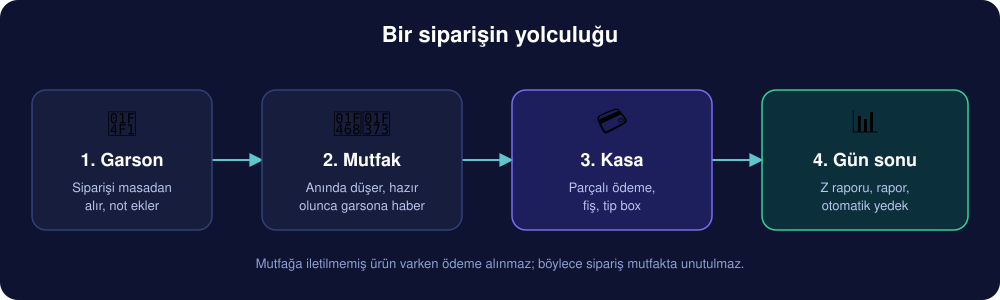

---

## ✨ Özellikler

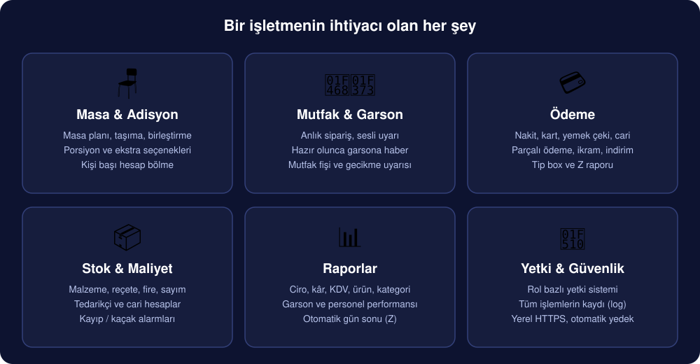

### 📱 Garson
- Telefon ve tabletle tam uyumlu mobil arayüz
- Masa ve kategoriye göre hızlı ürün seçimi, porsiyon ve ekstra seçenekleri
- Siparişe özel not ("az pişmiş", "buzsuz")
- Mutfaktan hazır çıkan siparişi görüp teslim edildi işaretleme
- Hesap servis ücretini kendisi ekleyebilir

### 👨‍🍳 Mutfak ve bar
- Yeni sipariş sesli uyarıyla ekrana düşer
- Hazırlanıyor / Hazır durumu, geciken siparişte renkli uyarı
- Mutfak fişi (M001, M002 numaralı)
- Mutfak raporu

### 💻 Kasa ve ödeme
- Masa planı, canlı adisyon tutarları
- Nakit, kredi kartı, yemek çeki, cari (veresiye) ve ikram
- Parçalı ödeme, kişi başı hesap bölme, tutar girerek ödeme
- Masa taşıma, birleştirme ve ürün aktarma
- İndirim, ürün iptali ve ikram (sebep zorunlu, hepsi kayıt altında)
- Termal yazıcıdan tek tıkla hesap fişi

### 💰 Tip box (bahşiş)
Müşteri hesaptan fazla para verirse sistem sorar: para üstü mü verilecek, yoksa tip box'a mı atılacak? Bahşiş ciroya girmez, garson bazında ayrı raporlanır ve gün sonunda Z fişinde ayrı satır olarak çıkar.

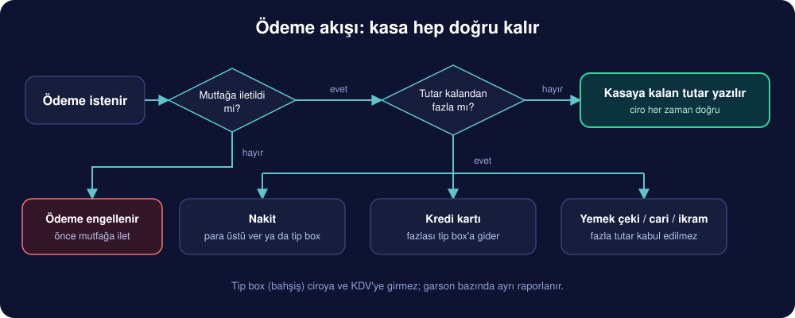

### 📦 Stok, maliyet ve cari
- Malzeme, reçete, alış / sayım / fire hareketleri
- Ürün maliyeti ve kâr marjı
- Tedarikçi, personel ve müşteri cari hesapları, ekstre ve tahsilat
- Kayıp / kaçak alarmları
- Kasadan çıkış giderleri (pazar alımı, fatura, avans)

### 📊 Yönetim ve raporlar
- Ciro, kâr, KDV, ürün ve kategori raporları
- Saatlik gelir trendi grafiği
- Garson ve personel performansı, mesai takibi
- İptal, mutfak, cari ve tip box raporları
- **Otomatik gün sonu (Z raporu)**, en geç gece yarısı

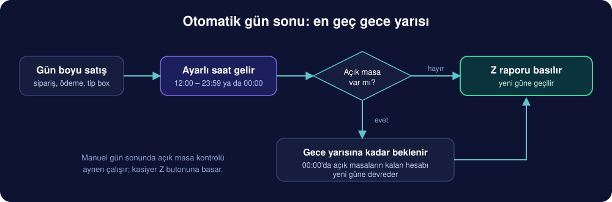

### 🔐 Güvenlik
- Rol bazlı yetki: garson kasayı, kasiyer ayarları göremez
- Her önemli işlem (fiyat değişikliği, silme, taşıma, giriş) işlem kaydına yazılır
- Yerel HTTPS, parola ve PIN ile giriş
- Zamanlı otomatik yedek, ayarlardan indirilebilir yedekler

---

## 🧭 Nasıl çalışır?

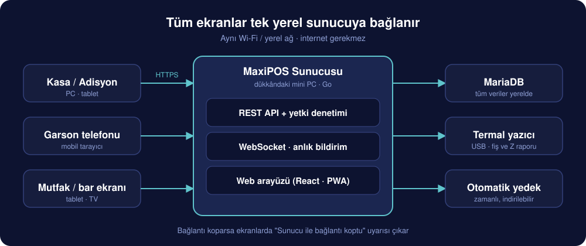

Kasa, garson ve mutfak ekranları aynı yerel ağdaki tarayıcılardan açılır. Hepsi dükkândaki tek MaxiPOS sunucusuna bağlanır; sunucu verileri MariaDB'ye yazar, fişleri USB termal yazıcıya gönderir ve yedekleri alır. Bağlantı koparsa ekranlarda **"Sunucu ile bağlantı koptu"** uyarısı çıkar.

---

## 📸 Ekran görüntüleri

### 🪑 Satış: masa planı
Boş ve dolu masalar bölgelere göre listelenir; dolu masada geçen süre ve güncel hesap görünür.

  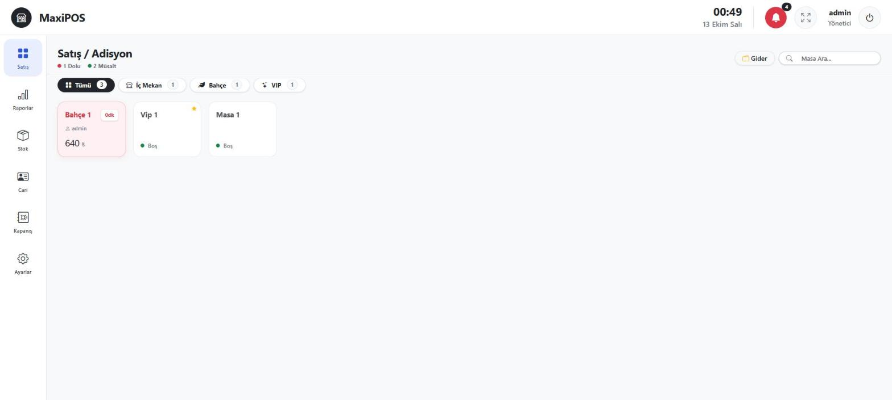

### 🧾 Masa adisyonu
Masaya tıklayınca açılan adisyonda fotoğraflı menü, hesap, tutar girerek ve kişi başı ödeme, nakit / kart / yemek fişi / cari butonları tek ekranda.

  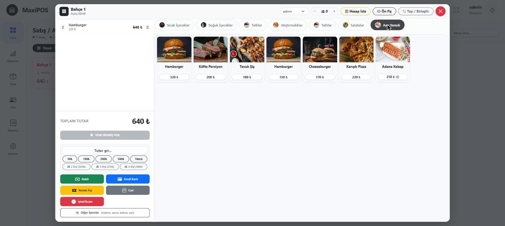

### 🍔 Menü yönetimi
Kategori, ürün, fiyat ve fotoğraf yönetimi Ayarlar içinde.

  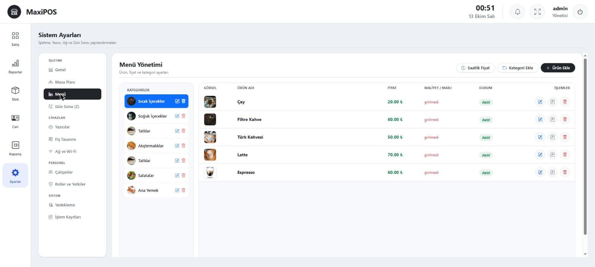

### 🗺️ Masa planı yönetimi
Masalar bölgelere (bahçe, iç mekan, VIP) göre gruplanır; ekleme, düzenleme ve ikon değiştirme tek ekranda.

  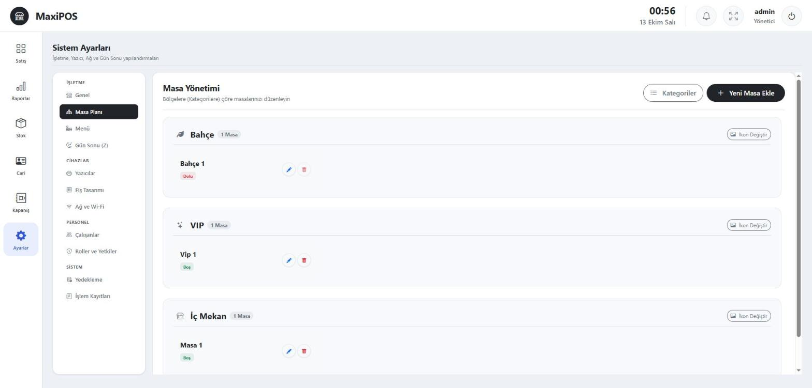

### 📦 Stok
Malzemeler satışta reçeteye göre otomatik düşer; kritik seviye uyarısı ve stok değeri anında görünür.

  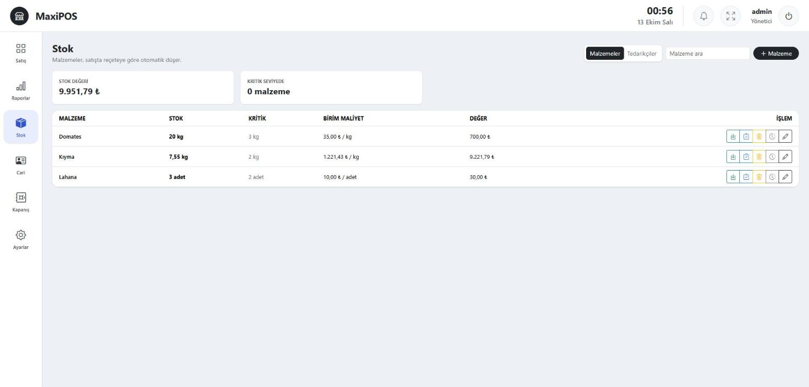

### 🔐 Roller ve yetkiler
Her role hangi ekranları göreceği ve hangi işlemleri yapabileceği tek tek verilir.

  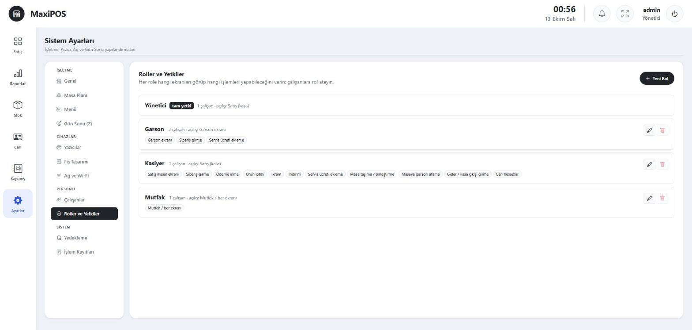

### 🌙 Gün sonu ayarları
Otomatik ya da manuel Z raporu, gün dönümü saati.

  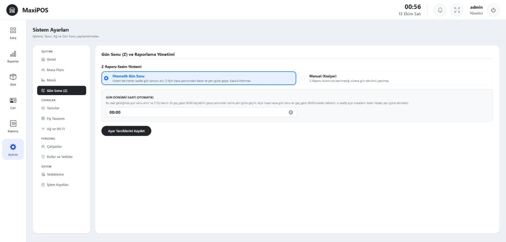

---

## 🔧 Teknoloji

| Katman | Teknoloji |
| --- | --- |
| Sunucu | Go, Fiber, GORM |
| Arayüz | React, Vite, Bootstrap, PWA (ana ekrana eklenebilir) |
| Veritabanı | MariaDB (yerel) |
| Anlık iletişim | WebSocket |
| Yazıcı | USB termal yazıcı (fiş, mutfak fişi, Z raporu) |
| Donanım | Mini PC (amd64, Debian/Ubuntu) |
| Tema | Açık ve koyu tema |

---

## 🚀 Kurulum

Kurulum dükkânda tek komutla yapılır, kurulumdan sonra sistem internetsiz çalışır.

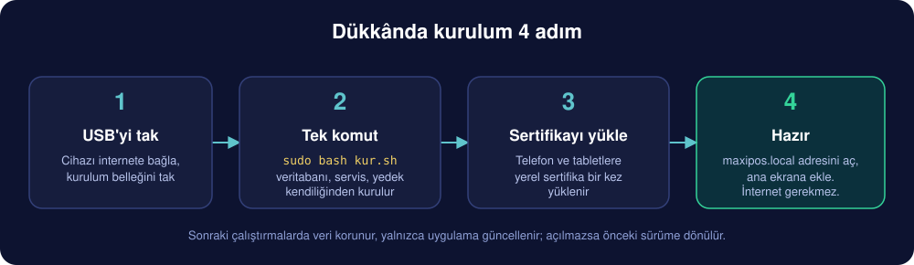

1. Cihazı internete bağlayın ve kurulum USB'sini takın.
2. `sudo bash kur.sh` komutunu çalıştırın.
3. Telefon ve tabletlere yerel sertifikayı bir kez yükleyin.
4. `https://maxipos.local` adresini açıp ana ekrana ekleyin.

Kurulum betiği veritabanını, servisi, otomatik yedeği ve yazıcı iznini kendisi hazırlar; sonraki çalıştırmalarda veriyi koruyarak yalnızca uygulamayı günceller ve açılmazsa önceki sürüme döner.

---

## 📞 Demo ve iletişim

Canlı demo, fiyatlandırma veya işletmenize özel geliştirme için bize ulaşın:

- 📧 **E-posta:** info@maxicode.com.tr
- 🌐 **Web:** https://maxicode.com.tr · https://adisyon.maxicode.com.tr

---

  © 2026 MaxiCode · Tüm hakları saklıdır.

