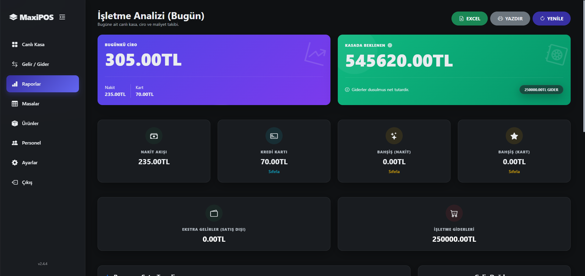
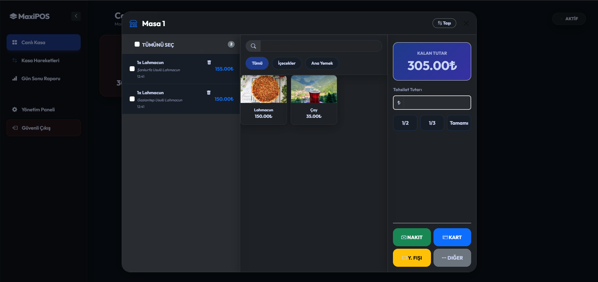
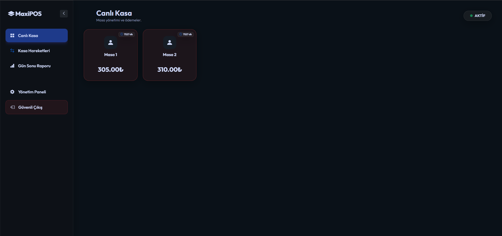
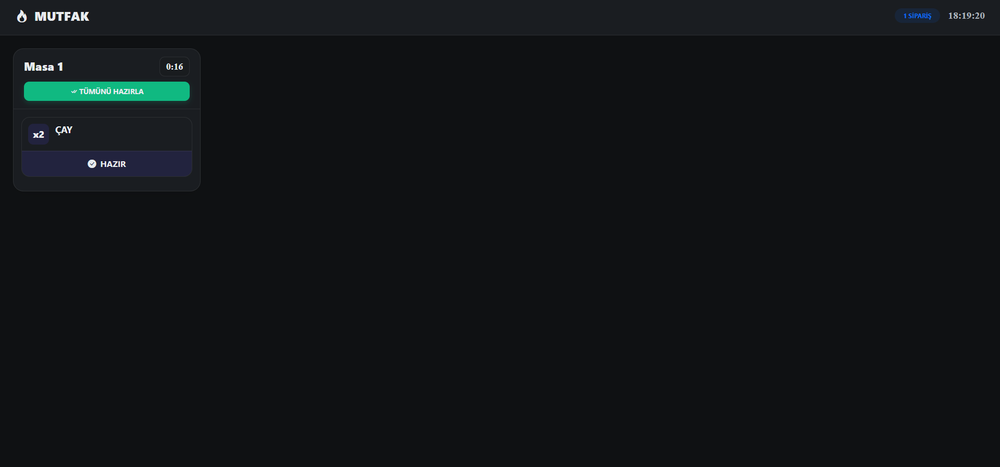
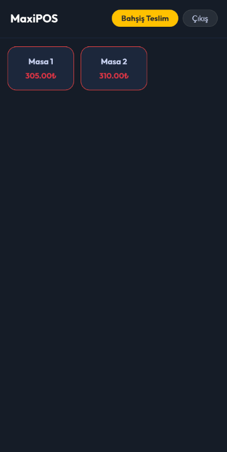
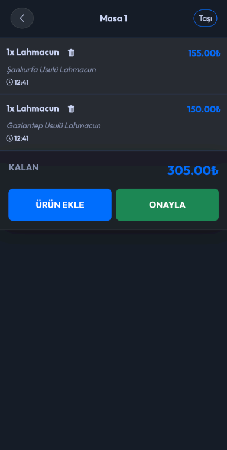

  
  <h1>🍽️ MaxiCode Adisyon & POS Yönetim Sistemi</h1>
  
<strong>Restoran, Kafe ve İşletmeler için Gelişmiş, Hızlı ve Güvenli Yönetim Sistemi</strong>

  <!-- Badges -->
  
  
  

 

> **Not:** Bu depo, **MaxiCode Adisyon** projesinin tanıtımı amacıyla oluşturulmuştur. Projenin kaynak kodları, ticari ve güvenlik nedenleriyle kapalı kaynak olarak tutulmaktadır. Detaylı bilgi, demo talebi veya satın alma için iletişime geçebilirsiniz.

## 🚀 Proje Hakkında

MaxiCode Adisyon, yeme-içme sektöründeki işletmelerin (restoran, kafe, bar vb.) siparişten ödemeye, mutfak yönetiminden detaylı raporlamalara kadar tüm süreçlerini tek bir çatı altında toplamalarını sağlayan kapsamlı bir **POS (Point of Sale)** ve adisyon otomasyonudur.

Sistem, işletme içindeki farklı rollere (Garson, Aşçı, Kasiyer, Yönetici) özel olarak tasarlanmış modüllerle tam entegre ve eşzamanlı çalışır.

---

## ✨ Temel Modüller ve Özellikler

### 📱 1. Garson Modülü
Sahada sipariş alan personelin hızını artırmak için optimize edilmiştir.
- Tablet ve telefonlarla tam uyumlu (Responsive) mobil arayüz.
- Masalara ve kategorilere göre kolay ürün seçimi.
- Siparişlere özel not (örn: "Az pişmiş", "Buzsuz") ekleme imkanı.
- Alınan siparişlerin anında mutfak ekranına ve yazıcılara iletilmesi.

### 👨‍🍳 2. Mutfak Modülü
Mutfaktaki karmaşayı önleyen, anlık sipariş takip ekranı.
- Yeni gelen siparişlerin sesli uyarı ile ekrana düşmesi.
- Hazırlanıyor / Hazır durum güncellemeleri.
- Geciken siparişler için renkli zaman uyarısı.

### 💻 3. Kasa ve Ödeme (POS) Modülü
Hızlı ve hatasız hesap alma işlemleri.
- Masalara göre güncel adisyon tutarlarını görüntüleme.
- Parçalı ödeme (Nakit, Kredi Kartı, Yemek Çeki vb.) alabilme.
- Masa taşıma, masa birleştirme veya adisyon bölme özellikleri.
- **Termal Yazıcı Entegrasyonu:** Tek tıkla hesap fişi çıkarma.

### 📊 4. Yönetim Paneli ve Raporlama
İşletme sahibinin her şeyi kontrol edebildiği komuta merkezi.
- Günlük, haftalık, aylık ciro ve kâr raporları.
- En çok satılan ürünler (Menü analizleri).
- Personel bazlı performans takibi.
- Kapsamlı stok, reçete ve maliyet yönetimi.

### 🔐 5. Güvenlik ve Yetkilendirme (Auth)
- Rol tabanlı erişim kontrolü (Garson kasayı göremez, kasiyer ayarları değiştiremez vb.).
- Tüm kullanıcı hareketlerinin sistem günlüğüne (log) kaydedilmesi.

---

## 💻 Teknolojik Altyapı

Bu proje, yüksek performans ve güvenlik standartları göz önünde bulundurularak geliştirilmiştir.

- **Mimari:** Modüler, MVC tabanlı yapı.
- **Backend:** PHP (Özel API Mimarisi)
- **Veritabanı:** Güçlü ve optimize edilmiş SQL yapısı.
- **Frontend:** Modern HTML5, CSS3, JavaScript (Responsive tasarım).
- **Donanım Entegrasyonu:** ESC/POS uyumlu ağ/usb termal yazıcılarla tam haberleşme.

---

## 📸 Ekran Görüntüleri

### 💻 Kasa & Yönetim Paneli (Yatay Ekranlar)

  
    
  
  

### 📱 Garson Mobil & Mutfak (Dikey & Tablet Ekranlar)

  
    
  
  &nbsp;&nbsp;&nbsp;&nbsp;
  

---

## 📞 İletişim & Demo Talebi

Projemizi incelediğiniz için teşekkür ederiz. Canlı demo, fiyatlandırma veya projeye özel modül geliştirme (örneğin işletmenize özel entegrasyonlar) talepleriniz için aşağıdaki kanallardan ulaşabilirsiniz:

- 📧 **E-posta:** info@maxicode.com.tr
- 🌐 **Web Sitesi:** https://maxicode.com.tr | https://adisyon.maxicode.com.tr

---

  
<i>Bu proje gururla geliştirilmiştir. © 2026 MaxiCode</i>

